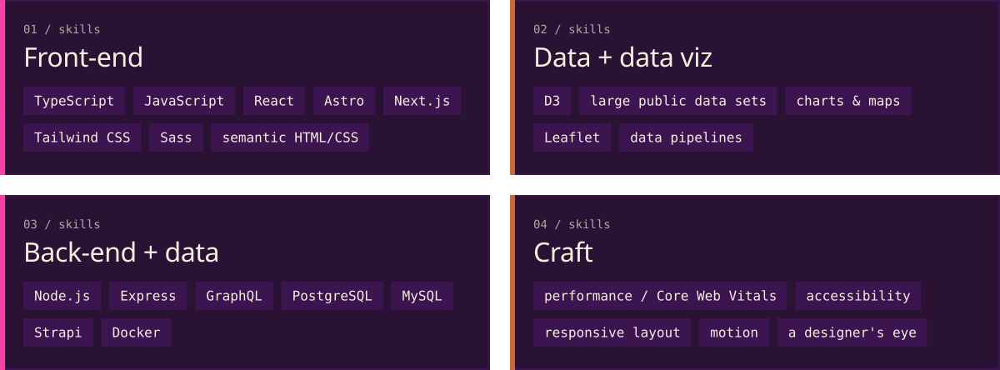

Self-taught since typing BASIC out of magazines on the family Commodore 64. 25+ years in: from agency work for brands like Lipton, TGI Fridays, Gaylord Opryland and Mervyn’s to lead dev on [World Population Review](https://worldpopulationreview.com). Based in East Tennessee.

Most of my work lives in private repos, so here’s the short version:

<picture>
  <source media="(max-width: 600px)" srcset="assets/skills-stacked.svg">
  
</picture>

**Also:** Puppeteer, Cheerio and Sharp for scraping and image pipelines · Vitest and Playwright for testing · Netlify, Vercel and custom VPS setups for hosting

Skills as plain text

- **Front-end:** TypeScript, JavaScript, React, Astro, Next.js, Tailwind CSS, Sass, semantic HTML/CSS
- **Data + data viz:** D3, large public data sets, charts & maps, Leaflet, data pipelines
- **Back-end + data:** Node.js, Express, GraphQL, PostgreSQL, MySQL, Strapi, Docker
- **Craft:** performance / Core Web Vitals, accessibility, responsive layout, motion, a designer's eye

### Lately, mostly in private repos

### Say howdy

Everything non-code lives down in my rabbit holes over at [www.stoutlabs.com](https://www.stoutlabs.com)... come visit sometime. 🐇🕳️ My email's there, too.
